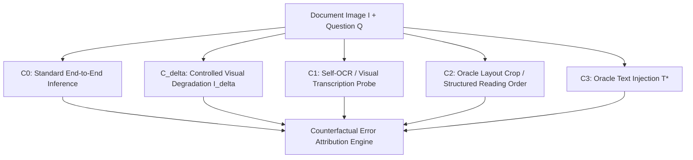

# Where Does Document Understanding Break?
**A Counterfactual Error-Propagation Study of Cascaded OCR and OCR-Free VLMs on Multilingual Indian Documents**

[](https://www.python.org/downloads/)
[](#hardware-aware-execution-rtx-3050-6gb)
[](LICENSE)

## Overview

End-to-end Document Question Answering (DocQA) benchmarks typically report aggregate task metrics (ANLS, Exact Match, F1), obscuring *where* and *why* pipelines fail. When a system answers a question incorrectly on a multilingual or visually degraded document, how much of the failure originates from:

1. **Visual Perception ($\mathcal{E}_{\text{vis}}$)**: Sensitivity to blur, resolution loss, ink bleed, or camera perspective distortion.
2. **Script & Text Recognition ($\mathcal{E}_{\text{rec}}$)**: Character/matra/conjunct recognition errors in Indic abugida scripts and code-mixed spans.
3. **Layout & Spatial Grounding ($\mathcal{E}_{\text{lay}}$)**: Inability to localize the answer-bearing region or preserve multi-column/tabular reading order.
4. **Semantic & Cross-Lingual Reasoning ($\mathcal{E}_{\text{sem}}$)**: Failure to infer the answer even when ground-truth localized text is supplied.

This repository implements a **Counterfactual Stage-wise Attribution Framework** across **Patram-Bench**, **IndicVisionBench**, and **FUNSD**, designed to run reproducibly on consumer hardware (NVIDIA RTX 3050 6GB VRAM).

---

## Counterfactual Intervention Protocol

Unlike prior comparisons that only inject oracle text into cascaded OCR+LLM pipelines, we isolate failure stages across **both OCR-based and OCR-free Vision-Language Models (VLMs)** using five controlled conditions per document-question pair $(I, Q, A^*)$:



| Condition | Input Provided to Model | Isolates |
| :--- | :--- | :--- |
| **$C_0$ (Clean Baseline)** | Clean image $I$ + Question $Q$ | Baseline end-to-end error |
| **$C_\delta$ (Degraded Input)** | Perturbed image $I_\delta$ + Question $Q$ | **Visual Robustness Gap** ($\Delta_{\text{vis}} = \text{Acc}(C_0) - \text{Acc}(C_\delta)$) |
| **$C_1$ (Self-OCR Probe)** | Prompt VLM to transcribe region first, then answer | **Read-Reason Dissociation** (can the VLM read what it fails to reason over?) |
| **$C_2$ (Oracle Layout)** | Ground-truth BBox crop $I_{\text{crop}}$ (VLM) or ordered blocks (OCR) | **Layout Localization Error** ($\Delta_{\text{lay}} = \text{Acc}(C_2) - \text{Acc}(C_0)$) |
| **$C_3$ (Oracle Text)** | Ground-truth transcript $T^*$ + Question $Q$ | **Recognition vs. Reasoning Split** ($\Delta_{\text{rec}} = \text{Acc}(C_3) - \text{Acc}(C_2)$, $\mathcal{E}_{\text{sem}} = 1 - \text{Acc}(C_3)$) |

---

## Datasets & Baselines

### Benchmarks
- **Patram-Bench** ([Srinivasan et al., 2026](https://patrambench.github.io/)): Stratified subset across Indic scripts, code-mixed documents, and key-value/VQA tasks.
- **IndicVisionBench** ([Faraz et al., ICLR 2026](https://huggingface.co/datasets/krutrim-ai-labs/IndicVisionBench)): Level-4 Wikisource OCR ground-truth pages (`ocr` split) paired with multilingual VQA (`vqa_indic` & `vqa_en`).
- **FUNSD** ([Jaume et al., 2019](https://guillaumejaume.github.io/FUNSD/)): Structured form understanding baseline with ground-truth entity bounding boxes and links.

### Evaluated Systems
1. **Traditional OCR Cascade**: `Tesseract 5` (Indic + English packs) $\to$ Quantized Instruct LLM (`Qwen2.5-3B-Instruct`).
2. **Neural OCR Cascade**: `PaddleOCR (PP-OCRv4)` / `Surya OCR` $\to$ Quantized Instruct LLM (`Qwen2.5-3B-Instruct`).
3. **OCR-Free VLM (Primary)**: `Qwen2.5-VL-3B-Instruct` (evaluated across NF4, INT8, and FP16/BF16).
4. **OCR-Free VLM (Secondary)**: `SmolVLM-2.2B-Instruct` / `PaliGemma2-3B-pt-448`.

---

## Repository Structure

```text
├── configs/
│   ├── experiment_config.yaml       # Reproducible hyperparameters, quantization & seeds
│   └── param_ganga_config.yaml      # 2x V100 HPC scaling profile
├── docs/
│   ├── research_protocol.md         # Experimental methodology & workshop paper blueprint
│   └── paper_readiness_and_improvements.md  # Acceptance assessment + change log
├── scripts/
│   └── run_experiment.py            # CLI: data prep, inference, sweep, attribution, stats
├── src/
│   ├── data/
│   │   ├── schema.py                # Dataclasses for documents, perturbations, and conditions
│   │   └── datasets.py              # Streaming loaders for Patram-Bench, IndicVisionBench, FUNSD
│   ├── perturbations/
│   │   └── degrade.py               # Controlled visual degradations & bbox layout interventions
│   ├── models/
│   │   ├── ocr_pipeline.py          # Tesseract / PaddleOCR + Text-QA cascade runners
│   │   └── vlm_runner.py            # Memory-bounded OCR-free VLM counterfactual runner
│   ├── routing/
│   │   ├── features.py              # 7 lightweight image/script routing features
│   │   └── router.py                # Accuracy-cost router + CV Pareto evaluation
│   ├── evaluation/
│   │   ├── metrics.py               # CER, WER, MER, ANLS, EM, F1, HAR, failure modes
│   │   ├── attribution.py           # Telescoping causal decomposition & grouped summaries
│   │   └── statistics.py            # Bootstrap CIs, paired tests, Holm-Bonferroni
│   └── utils/
│       ├── prediction_cache.py      # Resumable JSONL prediction cache
│       └── seed.py                  # Global deterministic seeding
└── tests/
    ├── test_metrics_and_attribution.py
    ├── test_router_and_ablations.py
    ├── test_statistics_and_failure_modes.py
    └── test_cache_and_sweep.py
```

## Quickstart

```bash
# 1. Install dependencies
pip install -r requirements.txt

# 2. Run unit tests for metrics, perturbations, and error attribution
pytest tests/

# 3. Run a dry-run counterfactual evaluation pipeline (resumable cache)
python scripts/run_experiment.py --config configs/experiment_config.yaml \
  --mode dry_run --resume --seed 42

# 4. Run the full 5-perturbation x 5-severity sweep
python scripts/run_experiment.py --config configs/experiment_config.yaml \
  --mode dry_run --sweep --resume --seed 42
```

Dry-run predictions are synthetic and intended only for pipeline verification;
they are not experimental evidence.

## Paper Readiness

`docs/paper_readiness_and_improvements.md` contains an honest acceptance
assessment (current state vs. executed study), the reviewer objections that must
be addressed, the minimum experiment package, and a commit-by-commit record of
the rigor improvements in this repository.
